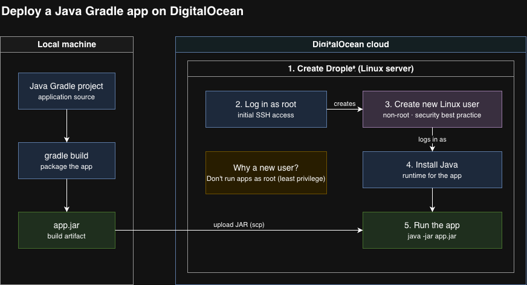

# Create Server and Deploy Application on DigitalOcean

Provisioned a Linux server on DigitalOcean and deployed a Java Gradle application to it, following security best practices.

## Architecture

## What I did

- Created and configured a cloud server (Droplet) on DigitalOcean
- Set up a dedicated non-root Linux user and SSH key authentication
- Built the app with Gradle and deployed the JAR to the server
- Ran the application as the non-root user

## Skills demonstrated

Cloud infrastructure basics, Linux administration, server security (least privilege), build and deployment of Java applications
